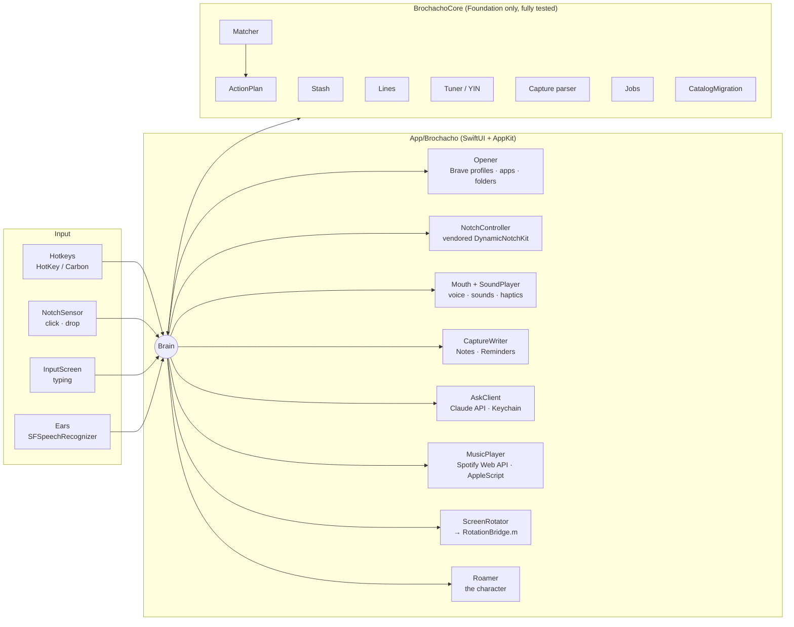
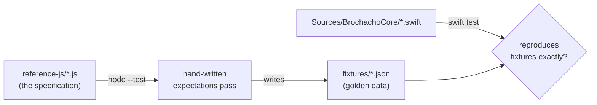

<div align="center">

# Brochacho

**A launcher that lives in the MacBook notch and answers in an Italian accent.**

Type the name of a thing and it opens. Drop a link on the notch and it is saved. Click the notch when you are bored and it hands one back.

[](https://github.com/adisharma200606-star/brochacho/actions/workflows/ci.yml)
&nbsp;macOS 13+ · Swift / SwiftUI / AppKit · Objective-C · JavaScript reference brain · 111 automated tests

</div>

```
                      ╭──────────────────────────────────────────────╮
                      │  yt▌                                         │
                      │  ┃ 01  youtube  ················ brave / personal
                      │    02  youtube music  ·········· brave / personal
                      │    03  steam  ··························· app
                      ╰──────────────────────────────────────────────╯
                                   — it's done. don't ask how.
```

---

## In thirty seconds

- **What it is:** a native macOS app that turns the notch into a command bar. `yt` opens YouTube in the right Brave profile, `timer 25` starts a countdown beside the notch, `remind me to call mom at 5` lands in Apple Reminders, `play beabadoobee` starts Spotify, `180` turns the screen upside down. After each action, a dry one-liner in an Italian accent: *"Nobody saw nothing. It's open."*
- **Why it is interesting:** it has a real product spine. A handful of rules, written into the spec before any code, decided every feature and killed most of the ideas proposed (see [the rules](#the-rules)).
- **How it was built:** I have no computer science background. I designed it, directed it and debugged it on real hardware; Claude (Anthropic's model) wrote most of the code under that direction. It was started **without a Mac**: the code was directed from a phone, and a GitHub cloud Mac was the only compiler. When a MacBook arrived, the app built and launched on the first day.
- **How it stays correct:** the app's brain is written twice, once in plain JavaScript as the specification and once in Swift, and the Swift must reproduce the JavaScript's output exactly, on every push. 139 matcher cases, 17 instrument tunings, the timer, the reminder parser, the jobs ledger: all pinned by golden fixtures.
- **Status:** I use it every day. Version 1 since 25 September 2026, version 2 since 11 October.

---

## Contents

1. [The problem](#the-problem)
2. [The rules](#the-rules)
3. [What it does](#what-it-does)
4. [How it is built](#how-it-is-built)
5. [Engineering decisions worth reading](#engineering-decisions-worth-reading)
6. [Three bugs, and how they died](#three-bugs-and-how-they-died)
7. [How it was made](#how-it-was-made)
8. [By the numbers](#by-the-numbers)
9. [Honest status](#honest-status)
10. [Run it yourself](#run-it-yourself)
11. [Map of the repo](#map-of-the-repo)
12. [Credits](#credits)

---

## The problem

My day on a laptop is dozens of small trips: open YouTube, open the course I am halfway through, find that link I saw yesterday, set a timer, write down a thought before it leaves. Each trip is three to ten seconds of hunting, and every one is a chance to get distracted on the way.

Spotlight and Raycast solve the hunting. They do not solve the other half: **things you save are never seen again**. Bookmarks rot. Read-later apps become guilt piles. They make you go and look, and nobody goes and looks.

Brochacho is built around one bet: hand saved things back at the exact moment you were about to go looking for a distraction anyway. Click the notch, or type `bored`, and you get *one* thing you saved. Not a list. One.

Everything else (the launcher, the voice, the timer) exists to make the notch the place your hands already go.

---

## The rules

Seven rules went into the spec before any code (`SPEC.md`); version 2 revised them into the six below, which every change, human or AI, is held to (`CLAUDE.md`). They are the most important thing in the repo, because they explain every "why not just add X?"

1. **The action happens first.** The line, the sound and the voice come after and never delay it. A joke that costs you half a second is a bug.
2. **Fast.** Under 1.5 seconds from Enter to the thing being open.
3. **Nothing to memorise.** The box matches *names*. There is no command language, no syntax, no `/commands`. If something is not "open a thing", it is a gesture, a hotkey, or a tool that is itself just a name (`timer 10`, `note buy strings`).
4. **He never speaks first.** Voice and sound only answer something you just did, or something you asked to be told (a timer ending).
5. **Nothing that watches you.** No streaks, no dashboards, no screen reading, no "I noticed you have been on YouTube for an hour".
6. **Scope is frozen per version.** New ideas go to a parked list until the current version runs on hardware.

**What the rules killed.** A full mafia character with a face (cut, then brought back in version 2 as one small sprite that only comes out when called). A custom command language ("it looks like a coding project, not a shortcut"). A typed wake phrase. Proactive suggestions. Productivity streaks. A TV-remote visual theme. Selling it. Each was a real proposal, discussed and dropped; the ones that shaped the design are recorded in `SPEC.md`.

---

## What it does

### Open anything by its name

Press `⌥Space`. The notch grows into a box. Type, press Enter, it opens, the notch closes.

| You type | You get | Why it works |
|---|---|---|
| `yt` | YouTube | an alias |
| `you`, `y` | YouTube | prefix match; ties go to what you open most |
| `code` | VS Code | matches a later word of the name |
| `vsc` | Visual Studio Code | acronym |
| `ytb`, `linkdin` | YouTube, LinkedIn | subsequence: dropped letters are forgiven |
| `steem`, `cloud` | Steam, Claude | edit distance: typos are forgiven |
| `yt berserk amv` | YouTube search results | the first word names a searchable site |
| `open the downloads folder` | ~/Downloads | filler words are dropped |
| `prime`, `calc` | Prime Video, Calculator | every installed app is indexed, no setup |

Sites open **in the right Brave profile** (personal vs work), by launching Brave's binary with `--profile-directory`. Apps open by bundle ID, with a fallback search by name if the ID is wrong. Folders open in Finder.

**If he is not sure, he does not guess.** Weak matches show with a `?` and wait for you to confirm. Opening the wrong thing is worse than opening nothing.

### Talk instead of type

Hold `⌃⌥Space`, say "YouTube", let go. Releasing the key ends the utterance, which is faster than any tap-to-talk button. Recognition runs on-device (Apple's Speech framework, nothing leaves the Mac), and the result goes through the same matcher, which already forgives the usual mishearings ("you to", "get hub", "what's app").

### The stash: save without filing, get back without looking

- **Save:** drag a link, text, image or file onto the notch. Or press `⌃⌥S` on any Brave tab. Or use the iPhone share-sheet shortcut. No folders, no tags, no questions: the moment a save tool asks where something goes, people stop using it.
- **Get back:** click the notch or type `bored`. One saved thing opens. An **another** button appears for a few seconds.
- **The serving rules** (tested): never serve the same thing twice; alternate between the last two weeks and older finds so nothing rots at the bottom; something skipped three times goes to the back of the queue.

### Bookmarks that remember where you stopped

A **living** entry opens wherever you last were, not where you first saved it. Reading chapter 14 of a manga? Press `⌃⌥M` and `bat` now opens chapter 14. When two living entries share a site, the one whose URL path looks most like the current page moves. When it still cannot tell (two Netflix shows with numeric URLs), it asks.

### Ask

The box is also an address bar for questions. `how do i undo a git commit?` or `what is a closure` goes to Claude Haiku and comes back as at most three plain sentences, streamed into the notch, with any command on its own line and a **Copy** button.

- `explain this` sends whatever you last copied (an error, a line of code). Without the word *this*, the clipboard is never sent.
- An exact name always beats a question: `what's app` opens WhatsApp.
- A **monthly budget cap** (default $2) is enforced locally from token counts. The API key lives in the macOS Keychain, never in a file or log.

### A guitar and ukulele tuner

`tune` turns the notch into a tuner. Pitch detection is the **YIN algorithm** (de Cheveigné and Kawahara, 2002), implemented from the paper, accurate to about a quarter of a cent on synthetic plucks for every string of every tuning. Seventeen tunings (standard, drop D, DADGAD, open G, baritone uke, low G and the rest), plus chromatic mode and custom tunings. The display only switches strings when two readings in a row agree, and only says "in tune" after the needle holds for a third of a second, so a knock on the desk never fakes it.

### Timer, notes, reminders

- `timer 25`, `timer 1h30`, `timer 1:30`, `10 min timer`, `set a timer for 90 seconds`: it reads them all, counting down beside the notch, with stop and +1/+5 minutes.
- `note buy new strings` creates an Apple Note. `remind me to call mom tomorrow at 5` creates an Apple Reminder for 17:00 that buzzes my phone, because it is Apple's own app and syncs for free. A hand-written time parser handles `in 20 minutes`, `next fri`, `tonight`, `at 9` (9:00 if still ahead, else 21:00), and leaves `watch 12 angry men` alone. The notch echoes what it understood (**call mom · Tomorrow 17:00**) so a misread never goes unnoticed.

### Jobs (version 2)

The day's to-do list, Sopranos-style: they are **jobs**, and unfinished ones are **owed**, never a streak. The difference from every other to-do app: **each job knows what to open.** `read 30 min` opens Books and starts a 30-minute timer. `finish the swift course` opens your course bookmark at the chapter you stopped on. If no starter is found, the next thing you open becomes that job's starter, and the verb is remembered for every later job.

`jobs read 30 min, gym, duolingo by 10pm` adds three at once. Ticking one off fires a small pixel explosion. The list opens by itself once a day from 10:00, silently and without stealing the keyboard. The day runs 04:00 to 04:00, so a job typed at 1 a.m. belongs to the night before.

### The character (version 2)

One small pixel sprite lives in the notch. He leaves it on his own for one reason only: when a job is due, he flies out silently and waits to be clicked (click him for **start it · later · skip today**). Type `pet` and he flies out to be played with:

- rub the cursor over him for pixel hearts,
- drag and throw him (he tumbles, bounces off the screen edges, gets dizzy, grumbles),
- **Follow me** (he chases the cursor), **Fetch** (click anywhere and he flies there),
- `go home` and he flies back.

Left alone for 12 seconds he goes home; after 45 seconds he goes home regardless. His window is exactly his size and transparent around him, so clicks never get swallowed. Drop any animated GIF or PNG frames into `~/.brochacho/character/` and he becomes that; `scripts/hat.py` finds the top of the head in every frame of a GIF and puts a pixel mafia fedora on it. A **macOS Focus filter** keeps him in the notch during, say, a Study focus.

### Music, diary, and the rest

- `play beabadoobee` resolves the artist through the **Spotify Web API** (client-credentials flow, keys in Keychain) and plays it via AppleScript. `pause`, `next`, `louder`, `volume 30` work too. Apple Music searches the local library instead.
- `diary long day, good one` appends a timestamped line to one Apple Note per day; at bedtime the day's jobs (done, skipped, owed) are written into the same note.
- `180` rotates the built-in display upside down through a private macOS framework (see [below](#the-screen-would-not-turn)).
- A settings window with **Add the page I'm on**, an app picker, a three-slide tutorial, eight generated interface sounds and trackpad haptics.

### The voice

Over **400 lines across 56 categories**, read in English by a macOS Italian system voice, which gives a thick accent for free. Lines are specific where they can be: open YouTube and you usually get a YouTube line. A tested picker never repeats any of the last five lines in a category, and a dial (default 60%) decides whether a line is also spoken or only shown. The text line always shows.

Every line follows the same rules: eight words or fewer, about the task or about you, never about Italians, never advice, never a question.

> *"I know a guy. He opened it."* · *"Bellissimo. She sings."* (every string in tune) · *"The interest is piling up."* (a job owed) · *"You throw like my cousin."* (after being thrown)

### The look

"Nocturne, liner notes": the back of a CD booklet, at night. Thin Helvetica Neue for what matters, IBM Plex Mono for everything else, lists that read like a track listing, one steel-blue accent, a hairline rim of light along the notch's edge and a little film grain. It was picked from three rendered directions, after earlier themes (an amber CRT look, then a softer "Aurora") were rejected as generic or too cute.

---

## How it is built



Two ideas explain most of the design.

**1. The brain decides, the app does.** `BrochachoCore` is a Swift package with no UI, no network, no clock and no randomness of its own: time and random numbers are passed in. That makes every decision (what did he mean, which saved thing comes back, which line is said, when is this job due) testable without a Mac, deterministic, and comparable line by line against a reference implementation. The app target is deliberately thin.

**2. One class knows everything; nothing else does.** `Brain.swift` is the only file that touches all the parts. Views hold no logic: they read a `NotchModel` and call closures on it. Every helper does one job and knows nothing about the others. Adding a feature is one short method on `Brain` plus whatever it calls.

### The test pipeline



Behaviour is defined **once**, in plain JavaScript that runs anywhere (including in the phone prototype), and checked **twice**. The Swift tests load the same JSON fixtures and must match them exactly. The rules are strict and written into `CLAUDE.md`: a failing Swift test means the Swift is wrong; fixtures are never edited by hand; changing behaviour means changing the JavaScript first.

### CI as the compiler

Every push to `main` runs on a GitHub `macos-15` runner:

1. the 51 JavaScript tests,
2. a check that the committed fixtures are exactly what the JavaScript produces,
3. `swift test` (60 tests),
4. `xcodegen` + a full `xcodebuild` of the app,
5. the real install script in build-only mode.

The regenerated Xcode project is committed back to `main` automatically, so opening the app needs no Homebrew or XcodeGen. Full logs are pushed to a `ci-logs` branch, readable with a plain `git fetch`: before the Mac arrived, that branch was how compiler errors reached a phone.

---

## Engineering decisions worth reading

**A matcher in bands, not a fuzzy score.** Most launchers compute one fuzzy number. Brochacho ranks every candidate into a *band* first (exact → prefix → word-prefix → acronym → subsequence → prefix-edit → edit distance), then by how often you open it, then by match quality, then alphabetically. Bands make the behaviour explainable ("`ytb` matched by subsequence") and make "is this safe to act on without asking?" a single comparison: only the top four bands open things from speech without confirmation. 139 cases pin it down.

**No command language, but tools that take words.** `timer 10`, `10 min timer`, `note buy strings`, `yt berserk`: the parser checks whether the first or last one or two words exactly name a site with a search URL or a tool that accepts words. Everything else is a name. Several unknown words are a question. That is the whole grammar, and it never needs explaining.

**Configs that migrate themselves, without resurrecting deletions.** `config.json` is written once on first launch, so built-in commands added in later updates never appeared for existing users (this was a real bug; see below). `CatalogMigration` adds each new built-in exactly once and remembers what it has offered in a separate file, so a built-in you deleted on purpose stays deleted. A broken config is never overwritten: defaults are used for that run and your file is left alone.

**Private API behind a verifying wrapper.** macOS has no public way to rotate a display. System Settings uses the private `MonitorPanel` framework, so the app does too, from a small Objective-C bridge (the category trick that lets Objective-C send messages the SDK does not declare). The important part is in Swift: it never trusts "success". It reads the public `CGDisplayRotation` afterwards and escalates through three methods if the screen did not actually move.

**Secrets never touch disk.** The Claude key and the Spotify client ID and secret live in the Keychain. Diagnostic logs (`~/.brochacho/music.log`, `flip.log`) record every step of an attempt and never a key.

**Stable code signing, so permissions survive updates.** macOS ties microphone, Reminders and automation permissions to the app's signature. The install script signs with an Apple Development identity when one exists, so an update does not re-ask for every permission.

**Documentation written for the owner.** I am not an engineer, so every comment explains *why*, in plain words. `docs/GUIDE.md` covers every feature with an honest **Status** line. `BLIND_SPOTS.md` lists every assumption that could not be checked without hardware, with the symptom to look for and the fix to try. When something broke on the Mac, the cause was usually already written down there.

---

## Three bugs, and how they died

### "Never heard of it"

`flip`, `settings`, `help` and `bored` all did nothing on my Mac while working perfectly in tests. The rotation code got the blame and two rounds of fixes. The real cause was upstream: my `config.json` had been written on first launch, before those commands existed, and a config that already has a catalog is used as-is. The commands were simply not in the list the matcher searched. The fix was `CatalogMigration`, and the lesson was to check that the request reaches the code before debugging the code.

### Music that searched, then did nothing

`play beabadoobee` found the right artist through Spotify's API, then silently failed to play. Two separate causes, found by logging every step to `~/.brochacho/music.log`: the AppleScript that tells Spotify to play was running on a background thread after the network call, where it fails without an error (it, and macOS's own permission prompt, must run on the main thread); and Spotify's `play track` only *opens the page* when given an artist address. The fix moved the player to the main actor and plays a track inside the artist or album context instead. The notch now says why when a key is wrong, instead of quietly falling back to a search page.

### The screen would not turn

Flip worked until an HDMI display was plugged in, then silently did nothing. The private call was being accepted and ignored. The rewrite stopped trusting it: each attempt is verified against `CGDisplayRotation`, and if the screen has not moved the next method is tried (a fresh `MPDisplay`, the `MPDisplay` from MonitorPanel's own display manager, then legacy IOKit). Requests name an absolute angle ("be at 180"), not a delta, so a slow first attempt cannot be undone by the second. Mirroring and clamshell mode are handled, and each attempt is written to a log one `cat` away. Fixed in one push, confirmed the same day.

---

## How it was made

I want to be precise about this, because it is the most transferable part.

**My part:** the product. The problem, the six rules, every feature decision and every "no", the visual direction picked from rendered options, the voice and its tone, and testing everything on real hardware, then turning "it doesn't work" into something specific enough to fix. I also decided the process: a reference implementation as the specification, golden fixtures, honest status lines, a document of blind spots.

**Claude's part:** most of the code, in Swift, Objective-C, JavaScript and Python, written to that process and explained to me as it went. The repo's `CLAUDE.md` is the brief any new session reads first, so the project survives the end of any one conversation.

**The constraint that shaped it:** when this started, I did not own a Mac. The JavaScript brain and a phone prototype (`prototype/`, a single web page with the real matcher, spring physics and a browser Italian voice) let me tune the feel on my phone. The Swift was written blind, and GitHub's cloud Mac was the compiler. When a MacBook arrived, I followed `DAY_ONE.md` and the app launched the first day. The one-command `scripts/install.sh` (pull, Release build, sign, install, relaunch) has shipped every update since.

What I learned, in one line each:

- Rules written before features save more time than any tool.
- A specification you can execute is worth more than one you can read.
- "Success" from an API is a claim. Verify the effect.
- When a feature dies on real hardware, check that the request is arriving before you blame the code that handles it.
- Write the guide for the person who will be confused at 1 a.m. That person is you.

---

## By the numbers

| | |
|---|---|
| Swift, the app | ~5,700 lines across 32 files |
| Swift, the brain (`BrochachoCore`, excluding generated files) | ~3,600 lines |
| Objective-C rotation bridge | ~180 lines |
| JavaScript reference brain + tests | ~2,700 lines |
| Automated tests | 51 JavaScript + 60 Swift, all green on every push |
| Golden matcher cases | 139 |
| Voice lines | 400+ in 56 categories |
| Tunings | 17, plus chromatic and custom |
| Interface sounds | 8, synthesised by a Python script (nothing sampled) |
| Third-party dependencies | 2 (DynamicNotchKit, vendored with 3 marked patches; HotKey) |
| From first commit to running on a Mac | 7 days (18 → 25 Sep 2026), most of them without one |
| Version 2 | 11 Oct 2026 |

---

## Honest status

| | |
|---|---|
| **Confirmed on my MacBook, used daily** | opening sites, apps and folders by name; Brave profiles; the notch box and the Nocturne look; settings and custom entries; the timer; screen flip, including with an HDMI display; Spotify by name; jobs; the character and `pet`; the install script |
| **Built and unit-tested, not yet individually confirmed on hardware** | hold-to-talk; the tuner's microphone path; Ask; Notes, Reminders and the diary; living bookmarks; the Focus filter; the iPhone shortcuts; Apple Music |
| **Not built** | calendar dates like "25 September" in reminders; live web search in Ask; a Mac App Store build (it uses a private framework and is not sandboxed, by design) |

Every unconfirmed assumption, with what to try if it is wrong, is in [`BLIND_SPOTS.md`](BLIND_SPOTS.md).

---

## Run it yourself

You need a Mac with a notch for the full effect (it falls back to a floating pill elsewhere), macOS 13 or later, and Xcode.

```bash
git clone https://github.com/adisharma200606-star/brochacho.git ~/Code/brochacho
~/Code/brochacho/scripts/install.sh
```

That builds a Release copy, signs it, installs it in `/Applications` and starts it. From a fresh Mac, [`DAY_ONE.md`](DAY_ONE.md) walks through every step, including Xcode's command-line tools. Run the same script again to update.

Then press `⌥Space` and type `help`.

To run the tests without a Mac UI:

```bash
node --test reference-js/*.test.js   # the specification
swift test                           # the Swift brain against the golden fixtures
```

Notes for anyone else running it: sites open in **Brave** with `personal` / `work` profiles (change the entries in settings), Ask needs your own Claude API key, and Spotify playback needs a free Spotify developer key. All keys go into the Keychain from the settings window.

---

## Map of the repo

| Path | What it is |
|---|---|
| [`docs/GUIDE.md`](docs/GUIDE.md) | The manual: every feature and setting, each with an honest status line. |
| [`docs/ARCHITECTURE.md`](docs/ARCHITECTURE.md) | How the code fits together, file by file. |
| [`SPEC.md`](SPEC.md) | The original design brief. |
| [`BLIND_SPOTS.md`](BLIND_SPOTS.md) | Every runtime assumption, and what to try if it is wrong. |
| [`DAY_ONE.md`](DAY_ONE.md) | Fresh Mac to running app. |
| [`CLAUDE.md`](CLAUDE.md) | The brief for an AI session picking up the project. |
| `reference-js/` | The brain in JavaScript: the source of truth for behaviour. |
| `fixtures/` | Golden test data written by the JavaScript tests. |
| `Sources/BrochachoCore/`, `Tests/` | The brain in Swift, Foundation only. |
| `App/Brochacho/` | The Mac app. `Brain.swift` is the place to start. |
| `App/RotationBridge/` | The Objective-C bridge to the private rotation API. |
| `App/Vendor/DynamicNotchKit/` | The notch window library, with three marked patches. |
| `defaults/` | The built-in catalog, the tunings and the voice lines, as JSON. |
| `scripts/` | Install, code generators, the sound synthesiser, sprite tools. |
| `prototype/` | The phone prototype, one web page. |
| `docs/IPHONE.md` | Two iPhone Shortcuts that share the stash. |

---

## Credits

- [DynamicNotchKit](https://github.com/MrKai77/DynamicNotchKit) by Kai Azim (MIT), vendored with three small patches for the glow, rim and grain.
- [HotKey](https://github.com/soffes/HotKey) by Sam Soffes (MIT).
- [IBM Plex Mono](https://github.com/IBM/plex) (SIL Open Font License).
- The YIN pitch detector follows de Cheveigné and Kawahara (2002). The rotation bridge uses the same widely documented technique as [Rotator](https://github.com/B-HS/rotator); no code was copied. Ideas, not code, from [Boring Notch](https://github.com/TheBoredTeam/boring.notch) and NotchDrop.
- Everything else, including the sounds, the grain texture and the bundled dragon sprite, was made for this project. Full details in [`REFERENCES.md`](REFERENCES.md).

---

<div align="center">

Built by **Adi Sharma**, BBA Decision Science at CHRIST University, Bengaluru.<br/>
GitHub: [@adisharma200606-star](https://github.com/adisharma200606-star)

*Made for one person. Shared because the process might be useful to the next one.*

</div>
